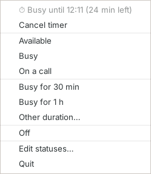
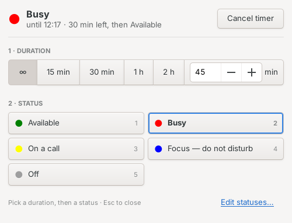
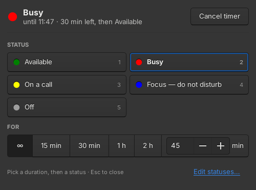
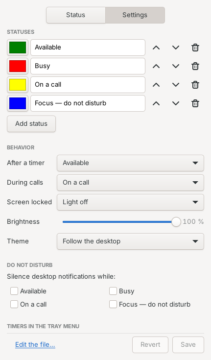
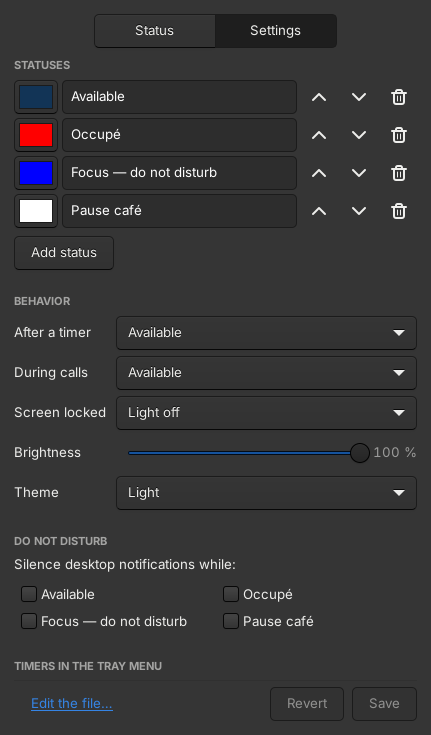

# luxafor-status-linux

[](https://github.com/NevilleDubuis/luxafor-status-linux/actions/workflows/ci.yml)
[](https://github.com/NevilleDubuis/luxafor-status-linux/releases/latest)

Control a **Luxafor** status light from Ubuntu, with:

- 🖱️ **a dock button** — click to cycle through statuses, right-click to pick one;
- 🪟 **a quick panel** — big status buttons and one-click durations;
- 🟢 **a system tray icon** that shows the current color;
- ⌨️ **a command** — `luxafor-toggle` — for scripts and keyboard shortcuts;
- 🎨 **your own statuses** — as many as you want, with any name and color;
- ⏱ **timers** — "busy for 30 minutes", then back to your default status;
- 📞 **automatic call status** — the light switches to a status of your choice
  while you're in a call in your browser (Teams, Odoo, Google Meet, Jitsi…);
- 🔒 **screen lock** — the light turns off (or a status of your choice) while
  your screen is locked, and comes back when you unlock;
- 🔕 **do not disturb** (optional) — desktop notifications silenced while you're busy;
- 🔌 **docking stations** — the status comes back when the light is plugged in again;
- ✨ **blinking statuses** — slow, normal or fast, handled by the light itself;
- 🔆 **brightness** setting; interface in **English and French**.

Default statuses:

| Status    | Color     |
|-----------|-----------|
| Available | 🟢 green  |
| Busy      | 🔴 red    |
| On a call | 🟡 yellow |
| Off       | ⚪ —      |

Luxafor's official software does not support Linux. This project talks to the
light directly through its documented USB HID protocol: **no driver to install,
no Python package, nothing but bash** for the light itself.

## Hardware support

> [!IMPORTANT]
> So far, this has **only been tested with the wired Luxafor ORB**, on Ubuntu Budgie.

Other Luxafor models that use the same USB protocol (such as the Flag) *should*
work, but haven't been verified yet. If you try one, please
open an issue or a PR to report whether it works — even a quick "works for me" helps.

## Installation

### apt repository (recommended)

For Ubuntu, Debian and derivatives — updates come with the rest of your system:

```bash
curl -fsSL https://nevilledubuis.github.io/luxafor-status-linux/key.asc \
  | sudo gpg --dearmor -o /usr/share/keyrings/luxafor-status.gpg
echo "deb [signed-by=/usr/share/keyrings/luxafor-status.gpg] https://nevilledubuis.github.io/luxafor-status-linux stable main" \
  | sudo tee /etc/apt/sources.list.d/luxafor-status.list
sudo apt update
sudo apt install luxafor-status
```

`apt` installs the dependencies, the udev rule and the launchers. The tray icon
and the call detection start at each login — to start them right away, open
**Luxafor Panel** from the app menu once (or log out and back in).

New versions then arrive with `sudo apt upgrade`. Use `testing` instead of
`stable` to get pre-releases (beta, release candidates) too.

> [!TIP]
> Already installed a `.deb` by hand? Just add the repository as above: your
> settings are kept, and the next versions come through `apt`.

### Debian package

Or download the latest `.deb` from the
[releases page](https://github.com/NevilleDubuis/luxafor-status-linux/releases/latest),
then:

```bash
sudo apt install ./luxafor-status_*_all.deb
```

You'll have to download each new version yourself — the apt repository above
does it for you.

### From source

For other distributions, or to try the latest changes:

```bash
git clone https://github.com/NevilleDubuis/luxafor-status-linux.git
cd luxafor-status-linux
./install.sh
```

The installer:

1. installs the required packages (GTK/AppIndicator bindings for the tray icon, `notify-send`);
2. adds a **udev** rule so the light can be used without `sudo`;
3. copies the scripts to `~/.local/bin`, adds the launcher to the app menu, and starts the tray icon at login.

It only asks for your `sudo` password for steps 1 and 2.
If the light doesn't respond right away, unplug and replug it.

> [!NOTE]
> Use one method or the other. If you switch from the source install to the
> package, run `./uninstall.sh` first.

Options:

| Option           | Effect                                         |
|------------------|------------------------------------------------|
| `--no-deps`      | don't install apt packages                     |
| `--no-udev`      | don't install the udev rule                    |
| `--no-autostart` | don't start the tray icon at login             |

## Usage

- **System tray**: the dot shows the current color. Right-click it:

  

  - a status in one click;
  - a timer in one click (`timer-shortcuts`, see [Settings](#settings));
  - **More…** opens the panel, for any duration and the settings (a
    middle-click on the dot too);
  - while a timer runs, the time left shows next to the dot and at the top of
    the menu, with **Cancel timer**.
- **Panel**: "Luxafor Panel" in the app menu, or **More…** in the tray menu.
  On the **Status** tab, pick a duration (∞ = no timer), then click a status.
  Keys `1`–`9` pick a status, `Esc` closes. The **Settings** tab is described
  [below](#customizing-statuses).

   

- **Dock**: "Luxafor" in the app menu — one click goes to the next status.
  Drag it (or "Luxafor Panel") to your dock.
- **Terminal**:

  ```bash
  luxafor-toggle              # next status
  luxafor-toggle busy         # set a status by its id
  luxafor-toggle busy --for 30   # for 30 minutes (also 45m, 1h, 1h30), then default status
  luxafor-toggle --timer      # time left
  luxafor-toggle --cancel-timer
  luxafor-toggle off
  luxafor-toggle --list       # list your statuses
  luxafor-toggle --current    # print the current status
  ```

  Or drive the light directly, without statuses:

  ```bash
  luxafor-light orange        # any color, see below
  luxafor-light off
  luxafor-light list          # connected lights
  ```

  Handy for a custom keyboard shortcut (Settings → Keyboard → Custom Shortcuts).

## Customizing statuses

Open the panel (**More…** in the tray menu) and go to **Settings**:

 

- **Statuses**: click a color to change it, edit the names, make a status
  blink (slowly, normally or fast — its dot blinks in the panel too), reorder
  or delete them, or add new ones. The dock button cycles through them in this order.
- **After a timer**: the status to go back to when a timer ends.
- **During calls**: the status used while you are in a call, or *Don't change*
  to turn call detection off.
- **Screen locked**: light off (default), a status, or *Don't change*.
- **Brightness**: from 5 to 100 %.
- **Theme**: follow the desktop, or force light or dark.
- **Do not disturb**: the statuses during which desktop notifications are
  silenced (none by default — you may want to see incoming calls).
- **Timers in the tray menu**: the timers offered in one click (up to 6).

Click **Save**: the tray, the dock button and the call detection pick the
changes up right away.

### The configuration file

Everything is stored in `~/.config/luxafor-status/statuses.conf`, which you can
also edit by hand (**Edit the file…** on the Settings tab, or
`luxafor-toggle --edit`). Saving from the panel rewrites it — comments are not
kept, the previous version is saved as `statuses.conf.bak`.

One status per line, as `id | color | label`, optionally followed by `| effect`:

```
available | green   | Available
busy      | red     | Busy
call      | yellow  | On a call | blink
focus     | #0000ff | Focus — do not disturb
lunch     | orange  | Lunch break | blink-slow
```

- **id** — the short name for `luxafor-toggle <id>` (lowercase letters, digits, `-`, `_`; `off` is reserved);
- **color** — a hex code (`#ff8800` or short `#f80`) or a color name: `red`, `orange`,
  `darkorange`, `gold`, `yellow`, `lime`, `green`, `springgreen`, `cyan`, `teal`,
  `skyblue`, `blue`, `royalblue`, `navy`, `purple`, `violet`, `magenta`, `pink`,
  `hotpink`, `crimson`, `coral`, `white`… (CSS names — `green` is CSS green, a darker
  green; use `lime` for full green);
- **label** — what you see in menus and notifications; any language, spaces allowed;
- **effect** (optional) — `blink`, `blink-slow` or `blink-fast`: the light blinks
  by itself until the status changes. Without it, the color is steady.

Add as many statuses as you like. The dock button cycles through them in file
order, then off. The tray icon picks up changes automatically when you save;
the dock's right-click menu is updated too (run `luxafor-toggle --reload` if
you edited the file while the tray icon wasn't running).

Your configuration is kept when you re-run `./install.sh`.

### Settings

The same file holds the settings, as `key = value` lines:

```ini
# Status to go back to when a timer ends (default: available, or your first status)
default-status = available

# Status during calls (default: call); "none" turns call detection off
call-status = call

# Apps that count as "in a call" when they use the microphone
# (matched against the app name; default: common web browsers)
call-apps = firefox chrome chromium brave msedge vivaldi opera

# Status while the screen is locked: a status, "off" (default), or "none"
lock-status = off

# Statuses during which desktop notifications are silenced (default: none)
dnd-statuses = busy

# Timers offered in one click in the tray menu: "<status> <duration>",
# separated by commas (default: your first non-default status, 30 min and 1 h)
timer-shortcuts = busy 30, busy 1h, focus 1h30

# Brightness of the light, 5–100 % (default: 100)
brightness = 100

# Look of the panel: auto (default), light or dark
theme = auto
```

With `theme = auto`, the panel follows your desktop: a dark GTK theme, or the
"prefer dark" style setting of GNOME / Budgie, gives a dark panel. `light` and
`dark` force it (with the standard Adwaita look).

`luxafor-toggle --settings` shows the values in use.

### Timers

`luxafor-toggle busy --for 30` (or a duration in the panel) sets a status
for a while, then goes back to `default-status` with a notification.

- Choosing another status by hand cancels the timer.
- A call doesn't: when the call ends, the light goes back to the timed status
  if the timer is still running, or to `default-status` if it ended during the call.
- Timers survive suspending the laptop. If you log out before a timer ends, it
  resumes at your next login (or ends right away if it's already over).

## Light unplugged (docking station, laptop on the move)

When the light is unplugged — say you take the laptop off its dock for a
meeting — the tray notices within a couple of seconds:

- the dot becomes a **dashed ring** in the status color, and the menu starts
  with **⚠ Light not connected**;
- a notification tells you the light is gone;
- you can still change status (menu, panel, timers, calls): it's kept and
  shown on the dashed ring.

When you plug it back in, the light shows the current status again, with a
notification. The same happens at login: the light picks up the status shown
in the tray. To do it by hand: `luxafor-toggle --apply`.

## Automatic call status

`luxafor-callwatch` starts at login and watches which applications use your
microphone. When your web browser starts recording — which is what happens when
you join a call in Teams, Odoo, Google Meet, Jitsi or any other web app — the
light switches to your `call-status` (**On a call** by default — see
[Settings](#settings)). When the call ends, it goes back to the status you had
before (unless you changed it yourself during the call).

It works with PipeWire and PulseAudio, needs no browser extension, and keeps
working when you mute yourself during the call.

To check what it sees, run this **during a call**:

```bash
luxafor-callwatch --check
```

The status used during calls and the watched apps are set in the
[settings](#settings) (`call-status`, `call-apps`); changes apply from the next
call. *Don't change* (`call-status = none`) turns call detection off.

> [!NOTE]
> Any recording by a watched app counts as a call — for example a voice message
> recorded in a browser tab, or the microphone test screen before joining a
> Teams meeting.

## Screen lock

When you lock your screen (a coffee, a meeting room), the light turns off — or
switches to the status set in **Screen locked** — and the status from before
comes back when you unlock. If the status changed meanwhile (a call, by hand),
it's left alone. A running timer keeps running.

It follows the screensaver of Budgie and GNOME (and KDE, Cinnamon, MATE, or
logind's lock hint). It's done by the tray icon, so it needs the tray to run.

## Do not disturb

Optional: tick statuses under **Do not disturb** in the settings, and desktop
notifications are silenced while one of them is on. Your own setting is put
back afterwards, also if the tray quits. It's off by default because you may
still want to see notifications of incoming calls.

It uses the desktop's own *Do not disturb* switch (Budgie's, or GNOME's
notification banners).

## Languages

The interface is in English and French, following your desktop's language.
The names of the shipped statuses are translated too, until you edit them.
Translations are welcome — see [CONTRIBUTING](CONTRIBUTING.md#translations).

## Troubleshooting

| Problem | Fix |
|---|---|
| "light not connected" notification, or a dashed ring in the tray | The light isn't detected: check the cable (or the dock), then run `luxafor-light list`. The status is kept and shown again when the light is back. |
| "cannot write to /dev/hidraw…" | The udev rule isn't active: unplug and replug the light. Still failing? With the package, run `sudo apt install --reinstall luxafor-status`; from source, re-run `./install.sh`. Then unplug/replug again. |
| "unknown color" notification | Check the color in your `statuses.conf` — try a hex code like `#ff8800`. |
| A status is missing from the menu | Run `luxafor-toggle --list`: invalid lines in `statuses.conf` are reported there. |
| `luxafor-light list` shows nothing | Run `lsusb \| grep -i 04d8`. If your light shows a different ID than `04d8:f372`, please open an issue — it's probably a model that isn't supported yet. |
| No tray icon | Make sure the "System Tray" applet is on your panel. On GNOME, install the *AppIndicator Support* extension. |
| Tray icon stops updating | Run `luxafor-tray &`: it replaces the running one. Errors are logged to `~/.cache/luxafor-tray.log` — please attach it to an issue. If an old icon stays behind, restart the panel (`budgie-panel --replace &` on Budgie) or log out and back in. |
| Call status doesn't switch | Run `luxafor-callwatch --check` during the call: is your browser listed? If it has an unusual name, add it to `call-apps`. If the call detection reports that `pactl` is missing: `sudo apt install pulseaudio-utils`. |
| `luxafor-toggle: command not found` | Log out and back in so `~/.local/bin` is on your `PATH`. |

## Upgrading from an earlier version

From 0.x to 1.0: `~/.config/luxafor-status/callwatch.conf` is no longer read.
Its settings moved to `statuses.conf` (`call-status`, `call-apps`; `enabled = no`
becomes `call-status = none`) — or set them in the panel. A notification
reminds you if the old file is still there.

Versions before the built-in driver used `busylight-for-humans`. Once the new
version works, you can remove it:

```bash
pipx uninstall busylight-for-humans
sudo rm -f /etc/udev/rules.d/99-busylights.rules
```

## Uninstall

Package (apt repository or `.deb`):

```bash
sudo apt remove luxafor-status
# and, if you added the apt repository:
sudo rm /etc/apt/sources.list.d/luxafor-status.list /usr/share/keyrings/luxafor-status.gpg
```

Your statuses stay in `~/.config/luxafor-status/` (delete that folder to remove them too).

Source install:

```bash
./uninstall.sh         # removes scripts, launchers and icons
./uninstall.sh --all   # also removes your statuses and the udev rule
```

## Contributing

Contributions are very welcome! This is a small hobby project, and help of any
size is appreciated:

- 🧪 **testing** with other Luxafor models or Linux distributions / desktops;
- 🌍 **translations** of the default statuses and messages;
- 🐛 **bug reports** and fixes;
- ✨ **ideas** — e.g. automatic status from calendar, screen lock or video calls.

See [CONTRIBUTING.md](CONTRIBUTING.md) to get started.

## Credits

- Luxafor, for publishing the HID protocol of their lights.
- [busylight-for-humans](https://github.com/JnyJny/busylight) by Erik O'Shaughnessy, which powered the first versions of this project.

## License

MIT — see [LICENSE](LICENSE).
